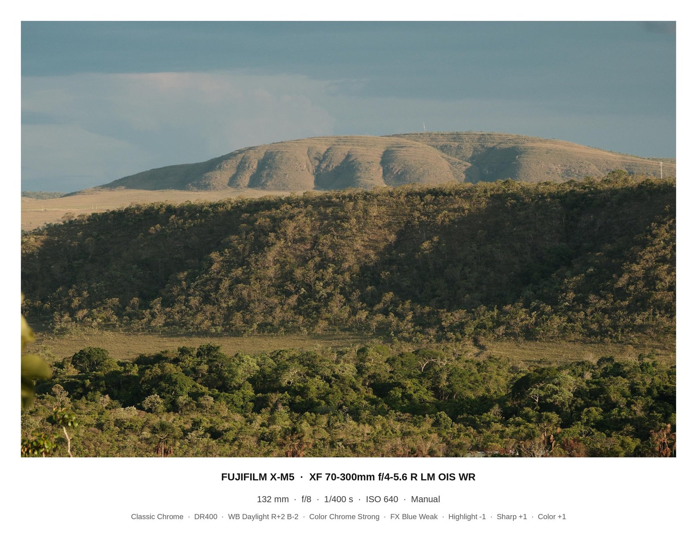

# Photo Frame Studio

Ein schnelles Werkzeug, um Fotos fürs Veröffentlichen aufzubereiten: Es setzt einen **weißen Rahmen wie bei einem Fotoabzug** um das Bild, schreibt **Aufnahmedaten** (Kamera, Objektiv, Belichtung, Fuji-Rezept bzw. Sony-Einstellungen) in den Rand und fügt optional ein **Wasserzeichen** ein. Die Ausgabegröße wählst du nach **Verwendungszweck** (E-Mail, Social Media, Web, Print).

**Alles läuft lokal im Browser – es werden keine Bilder hochgeladen.**

> Status: **Prototyp v1.0-rc4** (eine einzelne HTML-Datei). Die Weiterentwicklung zu einer installierbaren App ist in Planung, siehe [Roadmap](docs/ROADMAP.md) und [ADR 0001](docs/adr/0001-auslieferung-pwa-statt-desktop.md).



*Referenz-Layout, an dem sich der Prototyp orientiert.*

## Schnellstart

**Online:** https://jkstzs99dr-pixel.github.io/photo-frame-studio/ öffnen – fertig. Die Bilder bleiben trotzdem auf deinem Gerät, es wird nichts hochgeladen.

**Offline / als Datei:**

1. [`prototype/rahmen.html`](prototype/rahmen.html) herunterladen.
2. Per Doppelklick im Browser öffnen (Safari, Chrome, Edge oder Firefox, aktuelle Version).
3. JPGs oder RAWs ins Fenster ziehen.
4. Einstellungen wählen, dann **Speichern** (einzeln) oder **Alle als ZIP speichern**.

Tipp: Die Seite als Lesezeichen speichern, sie hat ein eigenes Icon.

## Funktionen (v1.0-rc4)

| Bereich | Funktion |
|---|---|
| Eingabe | Drag & Drop oder Dateiauswahl, mehrere Bilder gleichzeitig, sofortige Vorschau |
| Rahmen | Breite einstellbar; Modus **mit Aufnahmedaten** (breiterer Streifen unten) oder **gleichmäßiger Rahmen** |
| Text | Zeile 1: Kamera + Objektiv · Zeile 2: Brennweite, Blende, Zeit, ISO, Programm · Zeile 3 (abschaltbar): Kamera-Einstellungen |
| Fuji | Film-Simulation, Dynamikbereich, Weißabgleich + Feinabstimmung, Color Chrome, FX Blue, Highlight/Shadow, Sharpness, Farbe, Grain, Clarity |
| Sony | Creative Style, DRO, Belichtungskorrektur |
| Andere Hersteller | Basis-Exif, Belichtungskorrektur |
| RAW | ARW/SR2/SRF (Sony), RAF (Fuji); Best Effort: DNG, NEF, CR2, ORF – es wird das eingebettete Vorschau-JPEG genutzt |
| Wasserzeichen | Freier Text, halbtransparent unten rechts, Deckkraft einstellbar |
| Seitenverhältnis | Wie Bild · 1:1 · 4:5 (Instagram) · 9:16 (Story/Reels) · 3:2 / 2:3 (Fotoabzug) · 3:2/2:3 passend zur Bildausrichtung; auffüllen mit weißem Rand, Abzug mittig, nichts wird abgeschnitten |
| Presets | Standard: Instagram (4:5, 1350 px), Story (9:16, 1920 px), Print 10×15; eigene Presets mit allen Einstellungen speichern, löschen, als JSON exportieren/importieren |
| Ausgabegröße | Original · E-Mail (1200/1600 px) · Social Media (1080/1350/2048 px) · Web/Bildschirm (1920/2400/3840 px) · Print 300 dpi (10×15, 13×18, 20×30 cm, A4, 30×45 cm) |
| Export | Einzeln oder als ZIP, JPEG-Qualität einstellbar, Ausgabemaße pro Bild sichtbar |
| Metadaten | Exif der Originaldatei wird in die Ausgabe übernommen (Kamera, Objektiv, Belichtung, Aufnahmedatum, Fuji-Einstellungen). **Standort (GPS) nur mit Haken**, die Bildkarte zeigt, ob das Original einen Standort enthält. Optional **Autor und Copyright-Vermerk** (Exif, IPTC, XMP) |
| Sonstiges | Info-Fenster mit Funktionen und Einschränkungen, Einstellungen werden im Browser gemerkt, Favicon |

## Bekannte Einschränkungen

- **Metadaten nur teilweise:** Exif wird übernommen, aber ohne Sony-/andere Hersteller-Einstellungen, ohne XMP/IPTC aus dem Original (nur eigene Autor/Copyright-Angaben) und ohne Farbprofil. Details: [Exif-Mapping](docs/EXIF-MAPPING.md#exif-in-der-ausgabedatei-f-01).
- **Kein RAW-Entwickeln:** Bei RAWs wird das eingebettete Vorschau-JPEG verwendet, das je nach Kamera kleiner sein kann.
- **Sony** nur teilweise ausgewertet (Picture Profile, Weißabgleich fehlen); bisher nur mit synthetischen Testdateien geprüft.
- **Fuji**-Zuordnung mit X100VI (Acros, Nostalgic Neg., Provia DR200 hochkant) und X100F (Acros G, Provia) geprüft; X-M5, Classic Chrome und weitere Simulationen noch nicht.
- **Print:** keine dpi-Angabe in der Datei. Damit das Labor nicht beschneidet, Seitenverhältnis 3:2 bzw. 2:3 wählen.

Details: [docs/FEATURES.md](docs/FEATURES.md) und [docs/EXIF-MAPPING.md](docs/EXIF-MAPPING.md).

## Repository-Aufbau

```
prototype/rahmen.html       Aktueller Prototyp (Single-File, Referenzimplementierung)
scripts/rahmen_fuji.sh      Ursprüngliche Kommandozeilen-Variante (ImageMagick + exiftool, macOS)
docs/                       Dokumentation: Features, Roadmap, Exif-Mapping, Entscheidungen (ADR), Changelog
tests/fixtures/             Generator für synthetische Testdateien (Sony-JPEG, ARW, RAF, Fuji-JPEG)
tests/e2e/                  Browser-Tests (Playwright): Smoke-Test, Exif-Export, Autor/Copyright, GPS, Seitenverhältnis, Presets
CLAUDE.md                   Projektkontext für die Weiterentwicklung mit Claude Code
```

## Tests ausführen

Die Tests laufen bei jedem Pull Request automatisch auf GitHub (Chromium, WebKit/Safari-Engine, Firefox), siehe Reiter **Actions**.

Lokal (einmalig: Node.js, Python 3 und exiftool installieren, z. B. `brew install node python exiftool`):

```bash
npm install                                    # Playwright installieren
npx playwright install chromium webkit firefox # Test-Browser herunterladen
python3 -m pip install -r tests/requirements.txt
```

Dann bei jedem Testlauf:

```bash
python3 tests/fixtures/make_fixtures.py        # erzeugt Testdateien in tests/fixtures/out/
npm test                                       # alle Tests in allen drei Browsern
BROWSERS=webkit npm test                       # nur ein Browser
```

Einzelne Tests: `node tests/e2e/<name>.mjs` (smoke, exif, copyright, gps, ratio, presets, mapping), anderer Browser mit `BROWSER=webkit` bzw. `BROWSER=firefox`.

## Lizenz

[MIT](LICENSE) © 2026 Peter Tischer. Oberfläche und Doku sind auf Deutsch ([ADR 0003](docs/adr/0003-oeffentlich-deutsch-mit.md)).
